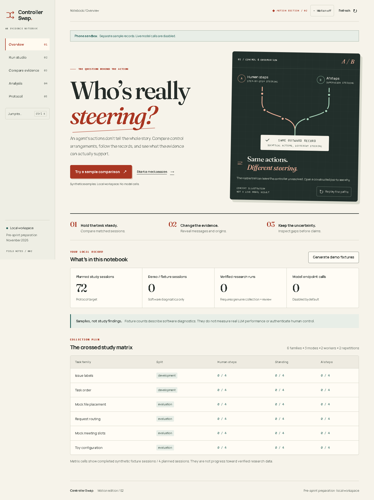

# Controller Swap

An evidence notebook for comparing who steers an agent—and what its visible
records can actually establish. Hold a mock task and worker steady, change the
control arrangement, then inspect matched traces at different levels of detail.

**Pre-sprint preparation for the November 27–29, 2026 Apart Agent Attribution
Hackathon. All code in this initial release predates the sprint. Deterministic
fixture diagnostics are software checks, not evidence of evaluator performance.**



## Try the notebook

Requires Python 3.12. The application uses the standard library and locally
bundled fonts; it has no frontend build step or runtime package download.

```sh
python -m controller_swap serve
```

Open <http://127.0.0.1:8766>. Records stay in `data/controller-swap.sqlite3`.
Live model calls are disabled by default. Stop with Ctrl+C.

1. Choose **Try a sample comparison**. This creates an idempotent pack of 72
   synthetic sessions if needed and selects a matched pair. No model call occurs.
2. Compare the **Outward activity** records. Constructed sessions with different
   setup labels can have identical evaluator inputs.
3. Select **Complete study records**, then **Compare evidence** again. Setup
   differences become visible; that alone does not validate attribution.
4. Use **Run studio** for an interactive mock session, **Analysis** for local
   diagnostics, or **Protocol** for exports and limitations.

**Ctrl/Cmd+K** opens quick navigation. The illustration has a replay control.
Motion settings persist locally and respect the device's reduced-motion setting.

For same-Wi-Fi testing, run the optional adapter with your computer's private IPv4:

```sh
python -m scripts.phone_preview --host <your-private-ipv4>
```

Open the complete temporary link it prints in your phone browser. It uses a
separate disposable sample database, disables live models and requires an access
link plus same-origin requests. The normal saved notebook stays separate. Keep
the computer awake. No public tunnel is created. Do not publish the printed link.

## What this does—and the limits

- Records mock tasks under human-step, standing-instruction and simulated AI-step
  arrangements; displays task correctness separately from attribution.
- Compares the exact selected evidence, including matching and changed records.
- Keeps abstentions, unsupported claims, missing predictions and failed attempts
  visible. Complete-view fixture recovery is a check by construction.
- Exports reproducible local records with hashes. A hash is not identity
  authentication and cannot defeat a privileged writer who recomputes it.

The historical small-model evaluator **did not work reliably**: its two saved
original predictions were wrong, and another request reached the inference
deadline. Later revised prompts also produced incorrect labels. These failures
are documented in [research status](docs/research-status.md), including what was
and was not measured. Browser input does not prove human authorship. No verified
human study or official challenge evaluation is claimed.

## Verify

```sh
python -m unittest discover -s tests -v
python -m controller_swap verify-fixtures --out artifacts/fixture-verification.json
```

Browser checks require Playwright (`requirements-dev.txt`) and an installed compatible Chromium browser
(the tests can fall back to Edge). They run isolated sample databases:

```sh
python -m tests.browser_flow --output artifacts/browser-check
python -m tests.design_browser --output artifacts/design-check
python -m tests.motion_browser --output artifacts/motion-check
```

Choose new output directories to retain earlier results. Tests that depend on
private historical request/response archives are intentionally not in this public
copy. Public-copy test results and the distinction from the full local development
suite are recorded in [validation](docs/validation.md).

## Project record

- [Competition rules and official submission destination](docs/competition.md)
- [Research status, original failures and outstanding gates](docs/research-status.md)
- [Design decisions and mobile screenshot](docs/design.md)
- [Publication scope and excluded local records](docs/publication-scope.md)
- [Third-party asset notices](THIRD_PARTY_NOTICES.md)

Maintained for Arham Begani. Design, implementation, research planning and testing
were extensively assisted by OpenAI Codex/ChatGPT. This is not a claim of unaided
human authorship; responsibility for any eventual submission remains with its
authors. Commit dates record publication preparation, not retrospective build dates.

No project-wide license has been selected. Bundled third-party font licenses
remain in effect; this repository does not grant additional rights to them.
