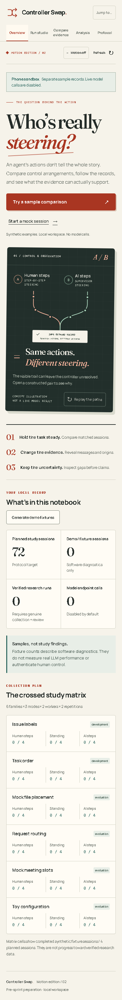

# An evidence notebook

The first screen introduces the attribution question, then opens a working
synthetic comparison. The workspace retains exact records, provenance boundaries,
failed attempts and uncertainty instead of implying a reliable detector.

The visual direction combines warm paper, dark ink, vermilion annotations and teal
for a second control path. Locally bundled Fraunces headings and Manrope interface
text distinguish editorial explanation from controls. The original SVG traces
converge on one outward record: a constructed illustration, not a finding.

The public homepages of [Hack Club](https://hackclub.com/),
[PostHog](https://posthog.com/), [Raycast](https://www.raycast.com/) and
[Linear](https://linear.app/) were inspected as references for warmth, a coherent
visual concept, direct task entry and hierarchy. Their branding, copy, artwork and
layouts were not copied. Raycast's hero was only partially rendered in one capture;
no claims about its native app experience informed this design.

Path animation is finite and replayable. Page and comparison transitions mark
changes. Motion-off preferences persist locally, with device reduced motion taking
priority. Navigation, keyboard focus, named scrollable regions, mobile diagnostic
disclosures and HTTP clipboard fallback support the primary workflow.

Actual screenshots were inspected at mobile, tablet and desktop widths; automated
reflow checks include 320 pixels. Contrast checks and keyboard review are bounded
verification, not a WCAG certification. No physical-device workflow, Safari or
screen-reader conformance is claimed.

